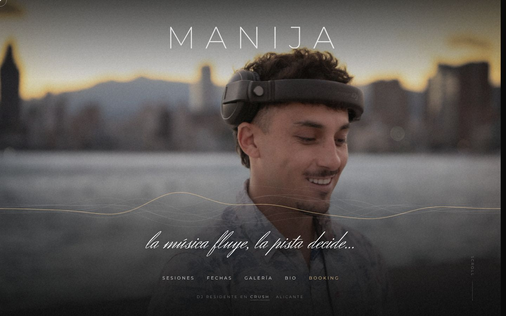
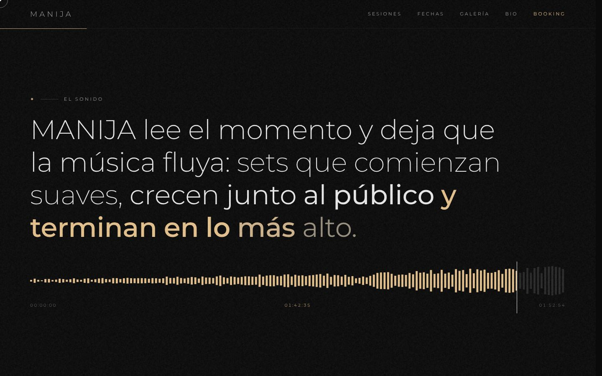
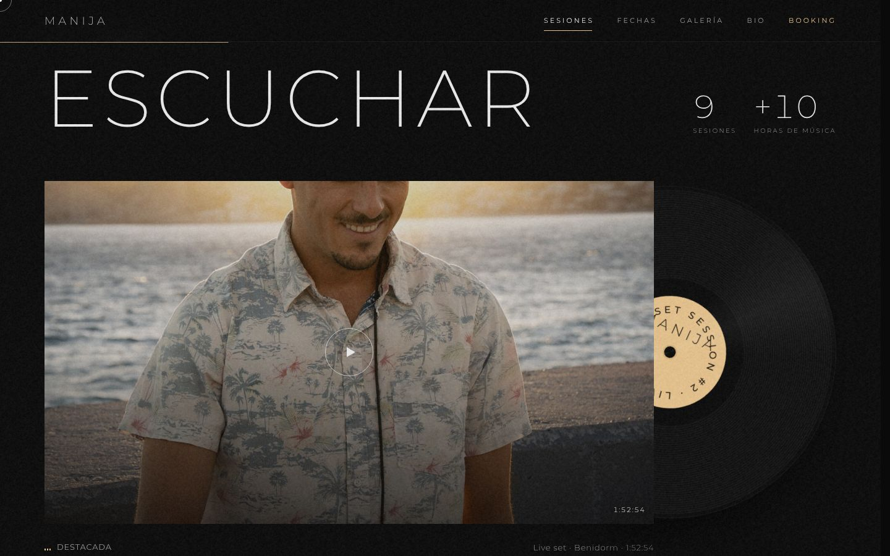
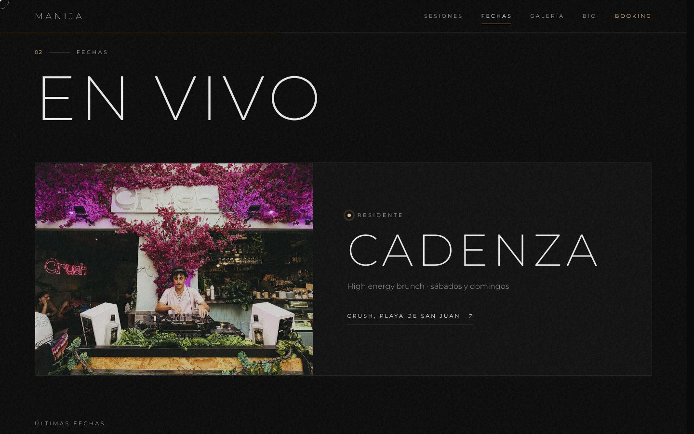
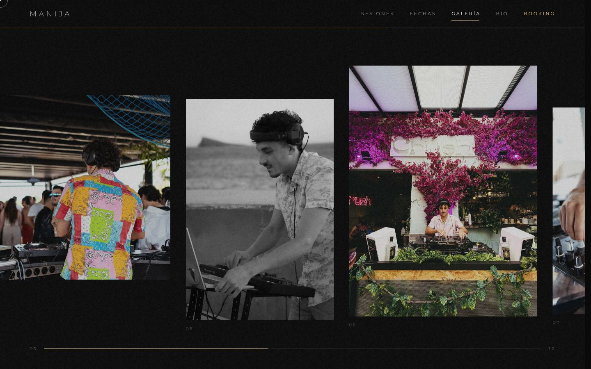
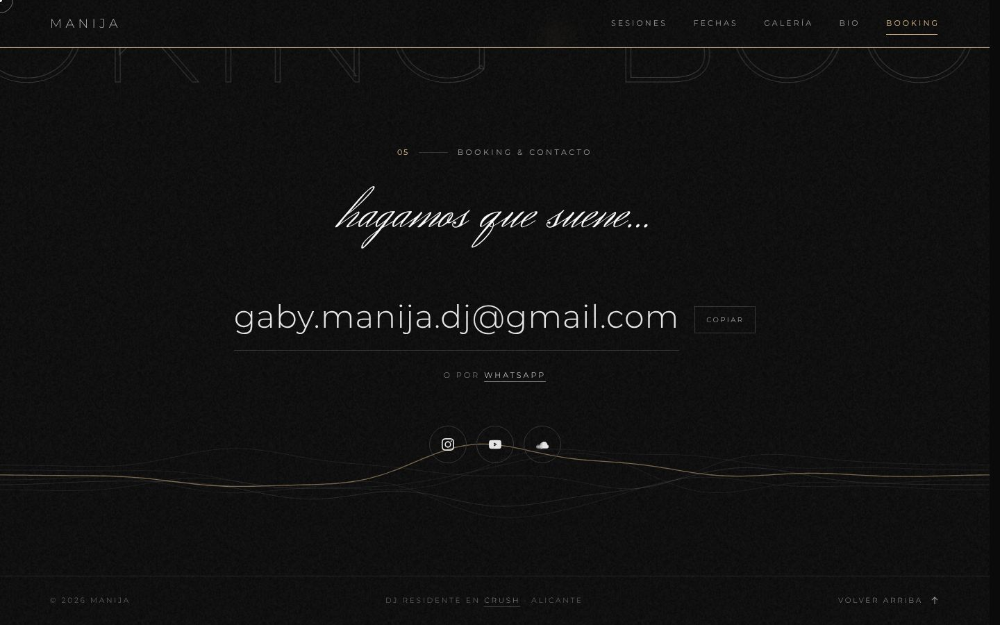
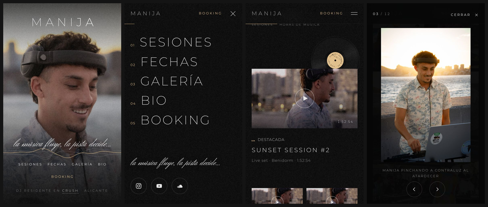

# manijadj.com

Web oficial de **MANIJA** (Gabriel Giraldi), DJ residente en Crush · Alicante.
Publicada en **https://manijadj.com**.

> **Rediseño.** Esta versión parte de la "Primera versión de la web" ([manija10-star/manijadj-web](https://github.com/manija10-star/manijadj-web)) y usa **los mismos textos, fotos, vídeos y enlaces**. Lo que cambia es la experiencia: una sola página que se recorre con el scroll, con animaciones en cada sección. El análisis de la versión anterior y la lista completa de cambios están en [REVISION.md](REVISION.md).



## Estructura

```
index.html   → toda la web (HTML + CSS + JS en un solo archivo, sin dependencias ni build)
img/         → las mismas fotos de la web original (sin cambios)
video/       → (opcional) hero.mp4 para la portada; si no existe, se muestra img/hero.jpg
docs/        → capturas del rediseño (no hacen falta para publicar)
```

- Sigue siendo una web estática: no hay framework, ni npm, ni paso de compilación, ni librerías externas.
- Para verla en local: abre `index.html` en el navegador o sirve la carpeta con `npx serve .` o `python3 -m http.server`.
- Para cambiar la web original por esta basta con sustituir `index.html`. La carpeta `img/` es la misma.

## Recorrido

| Sección | Qué pasa |
|---|---|
| **Intro** | "MANIJA" aparece letra a letra con una línea dorada y se levanta como un telón. Solo en la primera carga; si se entra con un enlace tipo `#booking`, no aparece. |
| **Portada** | Misma composición: nombre sobre la cabeza y lema debajo. La foto se aleja suavemente, el lema se "escribe a mano" y unas ondas de sonido doradas fluyen por la imagen y reaccionan al ratón. Con el ratón cerca, las letras de MANIJA ganan grosor. |
| **El sonido** | La frase de la bio sobre cómo es un set se ilumina palabra a palabra con el scroll y gana grosor: empieza fina y termina en dorado ("…en lo más alto"). Debajo, una forma de onda como la de un software de DJ avanza con el scroll y muestra el tiempo del set. |
| **Marquee** | "MANIJA ✦ la música fluye, la pista decide..." en movimiento continuo. Acelera, se inclina y cambia de sentido según la velocidad del scroll. |
| **01 · Sesiones** | La destacada tiene un vinilo que sale de la funda y gira como un plato real: acelera al pasar el ratón y va a 33⅓ rpm mientras suena. El resto se abre en un reproductor tipo cine. Las cifras (9 sesiones, +10 horas) se calculan solas con las duraciones. |
| **02 · Fechas** | La residencia de Crush tiene su propia tarjeta con un pulso "en directo". Las fechas se ordenan solas: las futuras pasan a "Próximas" y las pasadas a "Últimas fechas". |
| **03 · Galería** | En escritorio, una tira horizontal de fotos que se desliza con el scroll vertical, con parallax dentro de cada foto. En móvil, una rejilla donde la foto que pasa por el centro recupera el color. El visor amplía la foto desde su miniatura y permite pasar de foto con flechas, teclado o deslizando el dedo. |
| **04 · Bio** | El retrato se descubre como un telón y tiene parallax. El título entra letra a letra. |
| **05 · Booking** | "BOOKING" gigante en contorno desplazándose, "hagamos que suene..." escrito a mano, el email con botón de copiar, WhatsApp y redes con efecto magnético. |

En todo el sitio hay además grano de película, cursor propio con ratón ("Play" sobre los vídeos, "Ver" sobre las fotos), una barra de navegación que aparece al salir de la portada y marca la sección activa, menú móvil a pantalla completa y una barra de progreso dorada.

## Capturas

| | |
|---|---|
|  |  |
|  |  |





> En estas capturas las miniaturas de YouTube de las sesiones están sustituidas por fotos de la galería, porque se hicieron sin acceso a YouTube. En la web publicada se ve la miniatura real de cada vídeo.

## Mantenimiento

- **Añadir una fecha**: en `index.html`, dentro de `<ul id="gigs">`, copia un `<li class="gig">` y cambia `data-date` y `datetime` (formato `AAAA-MM-DD`), la fecha visible, el nombre y el lugar. Da igual dónde la pongas: si es futura aparece sola en "Próximas" y, cuando pase, baja a "Últimas fechas".
- **Añadir una sesión**: copia un `<button class="s-card">` y cambia `data-id` (el código del vídeo de YouTube), `data-title`, `data-dur`, la miniatura y los textos. Las cifras de sesiones y horas se recalculan solas.
- **Cambiar fotos**: sustituye los archivos de `img/` manteniendo el nombre. En la galería, cada foto tiene `--ar` (proporción ancho/alto) en su `style`: si cambias una vertical por una horizontal, actualízalo (por ejemplo `--ar:3/2`).
- **Vídeo de portada**: si se sube `video/hero.mp4`, se reproduce en bucle sobre la foto. Si no existe, se queda la foto.
- **Foto de portada vertical para móvil** (pendiente del README original): cuando exista, se puede añadir con un `<picture>` y un `<source media="(max-width: 760px)">` alrededor de `img.hero-img`.

## Reglas de marca (se mantienen)

- MANIJA es **"una experiencia, no un género"**: no se etiqueta la música con subgéneros.
- El lema **"la música fluye, la pista decide..."** va siempre en minúsculas y en Herr Von Muellerhoff.
- Paleta sobria: negro `#0a0a0a`, blanco roto `#ececec` y un único acento dorado `#e8c48e`. Las animaciones usan solo estos colores.
- La foto de portada deja la cara visible: el nombre va encima de la cabeza y el lema debajo.

## Accesibilidad y rendimiento

- Con **"reducir movimiento"** activado en el sistema no hay intro, parallax, cursor propio ni galería horizontal, y todo se muestra quieto.
- **Sin JavaScript** se ve todo el contenido (las animaciones son una capa extra).
- El reproductor y el visor son diálogos accesibles: el foco entra y vuelve al botón de origen, se cierran con `Esc`, el fondo queda inactivo y el visor se maneja con las flechas.
- Textos pequeños con contraste AA, enlace para saltar al contenido, títulos de sección reales para lectores de pantalla y datos estructurados (JSON-LD) para buscadores.
- Las animaciones van en un único bucle `requestAnimationFrame` que no mide el DOM en cada fotograma, y las ondas se pausan cuando no se ven. Los vídeos de YouTube (`youtube-nocookie`) solo se cargan al pulsar play.

## Cómo proponer cambios

La rama `main` del repositorio oficial está protegida: **nadie puede subir cambios directamente**.

1. Haz un *fork* del repositorio (o crea una rama si tienes acceso).
2. Haz tus cambios y abre un **Pull Request** hacia `main`, explicando qué has cambiado y por qué (con capturas si es algo visual).
3. El propietario revisa el Pull Request y, si está bien, lo aprueba y lo une a `main`.

## Publicación

La web está alojada en **Netlify** (proyecto `manijadj`). Los cambios **no se publican solos**: después de aprobar un Pull Request, el propietario sube la versión nueva a Netlify. Sigue siendo una carpeta estática, así que se sube tal cual.

## Pendiente

- ~~En la portada, que la palabra "Crush" de "DJ residente en Crush · Alicante" sea un enlace a https://www.crushculture.es/es.~~ Hecho en este rediseño.
- Sustituir las fotos por las de la próxima sesión de estudio (portada horizontal con espacio sobre la cabeza + versión vertical para móvil). Ver "Mantenimiento".
